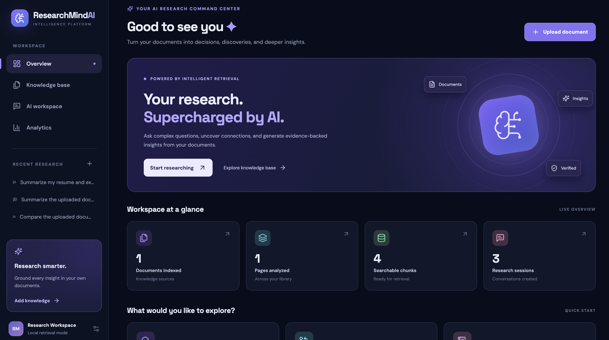
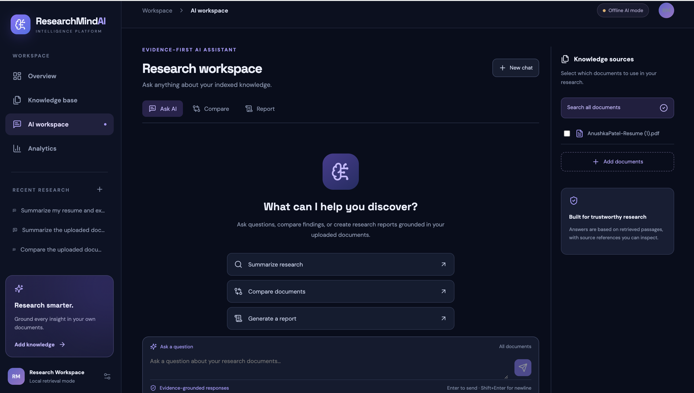
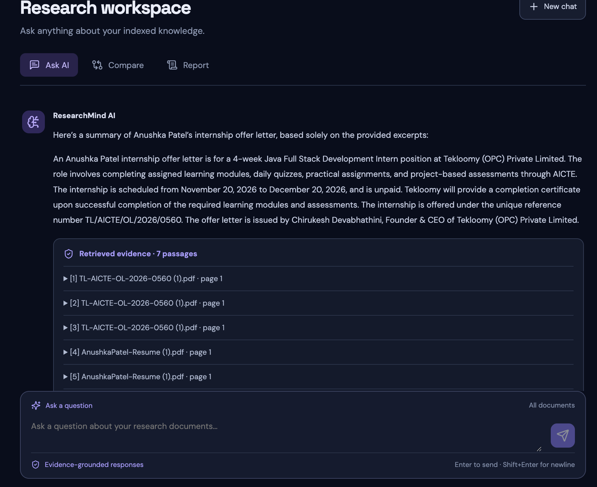
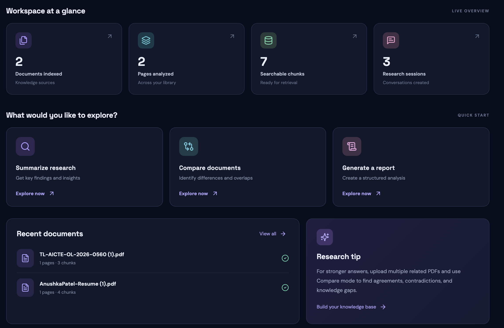

# ResearchMind AI 🧠

**An evidence-grounded AI research workspace** with a polished React dashboard, PDF ingestion, vector retrieval, multi-stage research workflow, citations, document comparison, report generation, conversation history, analytics, and API documentation.

> Portfolio-ready full-stack AI project. Built with React, FastAPI, ChromaDB, PyMuPDF, SQLite, and OpenAI (optional).

## Features

- 📄 Upload text-based PDFs and extract page-level passages
- 🔎 Chunk and index documents for retrieval with ChromaDB
- 🧠 **Four-stage research workflow:** plan → retrieve → synthesize → verify (explicit Python pipeline, not LangGraph)
- 💬 Ask questions with inspectable document/page citations
- ⚖️ Compare uploaded research papers and reports
- 📝 Generate structured reports grounded in retrieved excerpts
- 📚 Filter questions to selected documents
- 🕘 Persist chat history and document metadata with SQLite
- 📊 Dashboard with actual document, page, chunk, and session counts
- 🧪 Pytest unit tests and GitHub Actions CI
- 🐳 Docker Compose support
- 🔐 API key stored server-side, not exposed to browser


## 📸 Project Screenshots

### ResearchMind AI — Dashboard


### ResearchMind AI — Interface


### ResearchMind AI — Features


### ResearchMind AI — Application Preview


## Architecture

```text
React dashboard (Vite)
    │ REST /api
    ▼
FastAPI ─────────────── SQLite (documents, conversations, messages)
    │
    ├── PDF extraction (PyMuPDF) → overlapping chunks → ChromaDB
    │                                                │
    └── ResearchWorkflow: plan → retrieve ────────────┘
                              ↓
                        synthesize (OpenAI, optional)
                              ↓
                        verify / attach evidence → response
```

### Modes

- **Ask AI**: evidence-grounded question answering.
- **Compare**: contrasts selected sources, when an OpenAI API key is configured.
- **Report**: produces structured reports, when an OpenAI API key is configured.
- **No API key**: offline local retrieval with cited excerpts. It does *not* generate original LLM responses.

## Quick start (macOS / Windows / Linux)

### Prerequisites

- Python 3.11+ (3.11 recommended)
- Node.js 20+
- Optional OpenAI API key for semantic embeddings and LLM generation. API usage may incur charges.

### 1. Start the backend

```bash
cd backend
python3 -m venv .venv
source .venv/bin/activate    # Windows PowerShell: .venv\\Scripts\\Activate.ps1
pip install -r requirements.txt
cp ../.env.example .env     # Windows: copy ..\\.env.example .env
# Optional: edit .env to set OPENAI_API_KEY
uvicorn app.main:app --reload --port 8000
```

Visit http://localhost:8000/docs for interactive API documentation. On first start, Chroma may download dependencies/models depending on installed version; allow a moment.

### 2. Start the frontend (new terminal)

```bash
cd frontend
npm install
npm run dev
```

Visit **http://localhost:5173**.

### 3. Use the application

1. Open **Knowledge base** and upload a text-based PDF (15 MB max).
2. Open **AI workspace** and ask a question about its content.
3. Expand the cited passages to inspect evidence.
4. Set an `OPENAI_API_KEY` in `backend/.env` and restart the backend to enable LLM answers and semantic retrieval.

> **Important:** Set the API key before indexing documents and keep it consistent. Offline hashed vectors and OpenAI embeddings use different spaces. If you switch embedding modes, delete `backend/data/chroma` and re-upload documents. The current app does not auto-migrate indexes.

## Docker

```bash
docker compose up --build
```

Frontend: http://localhost:5173 · Backend: http://localhost:8000/docs

Set `OPENAI_API_KEY` in a root `.env` file (never commit it) before starting Docker if you want AI generation.

## Tests

```bash
cd backend
pytest -q
```

The tests cover chunking, overlap, similarity, deterministic embeddings, and empty-evidence workflow. CI also builds the frontend. Expand integration/evaluation tests before claiming production readiness.

## API reference

| Method | Route | Purpose |
|---|---|---|
| GET | `/api/health` | Health and AI configuration status |
| GET | `/api/stats` | Actual workspace counts |
| GET | `/api/documents` | List indexed PDFs |
| POST | `/api/documents` | Upload PDF as multipart form `file` |
| DELETE | `/api/documents/{id}` | Delete PDF index and metadata |
| POST | `/api/ask` | Ask/compare/report with evidence |
| GET | `/api/conversations` | List saved conversations |
| GET | `/api/conversations/{id}` | Read saved messages |

Example:

```bash
curl -X POST http://localhost:8000/api/ask \
  -H 'Content-Type: application/json' \
  -d '{"question":"Summarize the main findings","mode":"chat","document_ids":[]}'
```

## Limitations and next steps

This is a **portfolio-grade prototype**, not a production SaaS service. It currently has **no user authentication or tenant isolation**, so run it locally or add auth before deploying it publicly. Uploaded PDFs are indexed, not retained as downloadable originals. Scanned/image-only PDFs need OCR. Retrieval quality and citation correctness have not been benchmarked; citations identify retrieved evidence, not a guarantee that every generated claim is supported. The `verify` stage attaches provenance but does not perform independent LLM fact-checking. In offline mode, retrieval uses deterministic hashed token vectors with lexical reranking. A real deployment should add user accounts, per-user access control, upload malware scanning, rate limiting, observability, structured evaluation datasets, and stronger citation validation.

## Suggested portfolio description

> Built ResearchMind AI, a full-stack document intelligence platform using React, FastAPI, ChromaDB, and OpenAI. Implemented PDF ingestion, page-level vector retrieval, evidence-linked Q&A, document comparison, research report generation, persistent chat history, and a responsive analytics dashboard. Added automated backend tests and CI workflows.

## License

MIT — see [LICENSE](LICENSE).
